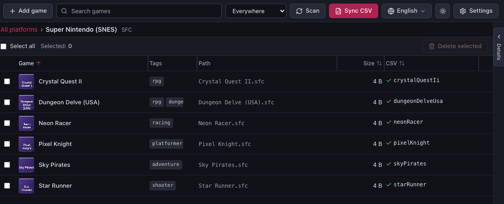
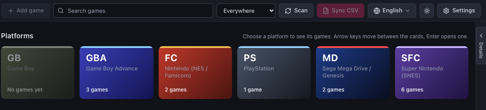

<b>English</b> · <a href="README.uk.md">Українська</a> · <a href="README.ru.md">Русский</a>

# Retro Game Manager

Manage the games on the SD card of your retro handheld console from your computer: add games, rename them, give them covers and tags, and keep your saves with them.

## Supported consoles

- SF3000
- SF3000 HD
- SF3000 HD without HDMI
- SF3100
- SF3500

## Download

Download the latest version for **Windows**, **macOS** and **Linux** from the [Releases page](https://github.com/StanislavDovhusha/retro_game_manager/releases).

| System | File |
| --- | --- |
| Windows | `Retro-Game-Manager-Setup-<version>.exe` (installer) or `Retro-Game-Manager-<version>-portable.exe` (runs without installing) |
| macOS, Apple Silicon (M1 and newer) | `Retro-Game-Manager-<version>-arm64.dmg` |
| macOS, Intel | `Retro-Game-Manager-<version>-x64.dmg` |
| Linux | `Retro-Game-Manager-<version>.AppImage` or `Retro-Game-Manager-<version>.deb` (Debian, Ubuntu, Mint) |

`SHA256SUMS.txt` on the release page holds the SHA-256 checksums of the files. To check a download, compare its checksum with the one in that file:

- **Windows (PowerShell):** `Get-FileHash .\Retro-Game-Manager-Setup-<version>.exe`
- **macOS:** `shasum -a 256 Retro-Game-Manager-<version>-arm64.dmg`
- **Linux:** `sha256sum -c SHA256SUMS.txt --ignore-missing` (run it in the folder with the downloaded files)

### First start of an app without a signature

The app is not signed with a paid developer certificate, so the system asks once before the first start:

- **Windows:** SmartScreen shows "Windows protected your PC". Click **More info**, then **Run anyway**.
- **macOS:** right-click (or Control-click) the app in **Applications** and choose **Open**, then **Open** again. Or try to open it once, then go to **System Settings → Privacy & Security** and click **Open Anyway**.
- **Linux:** make the AppImage executable — in its file properties, or with `chmod +x Retro-Game-Manager-*.AppImage` — and start it. The `.deb` package installs with `sudo apt install ./Retro-Game-Manager-*.deb`.

## How to use

> 💡 **Good to know:** We recommend backing up your SD card from time to time. It only takes a few minutes and keeps your games and saves safe.

1. **Choose the SD card.** Insert the card into your computer, click **Select SD card** and pick the card itself (its main folder). The app recognizes your console by the folders on the card. You can also choose the model in **Settings**.
2. **Choose a platform.** The main screen shows the platforms of the card with the number of games, for example GBA, SFC or PS. Click one (or pick it in the panel on the left): its games appear in the table. **All platforms** above the table brings you back.
3. **Add a game.** Click **Add game** and drop the game file into the window:
   - a game file of that platform (for example `.nes`, `.sfc`, `.gba` or `.md`), or a `.zip`;
   - a CD image: `.bin` + `.cue`, a CloneCD set (`.ccd` + `.img` + `.sub`) or `.ecm`. The app turns it into a single file the console can read.

   Add a cover picture (PNG, JPG or WEBP), or let the app draw a cover for you. Tags are added afterwards in the table.
4. **Edit or delete a game.** Double-click a game's title, short name or tags in the table to change them. **Rename game** in the **Details** panel renames the game together with its cover and saves. **Delete game file** removes the game from the card. Its cover and saves stay; remove the cover separately with **Delete image**.
5. **Search.** Type in the search box at the top to look through the games of all platforms at once.

When you start the app for the first time, a short tour shows these steps. You can start it again in **Settings → Restart tour**.

## Support the project

If Retro Game Manager saves you time, you can support it on [Ko-fi](https://ko-fi.com/stanislav31259). Each donation brings support for the next console a little closer.

A ⭐ star on [GitHub](https://github.com/StanislavDovhusha/retro_game_manager) helps other players find the project too.

## License

Retro Game Manager is free software under the GNU General Public License v3.0 (GPL-3.0). See [LICENSE.md](LICENSE.md).
