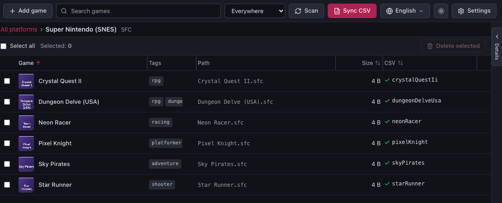
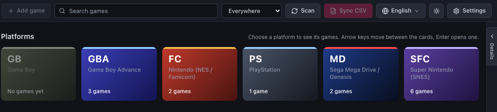

<a href="README.md">English</a> · <a href="README.uk.md">Українська</a> · <b>Русский</b>

# Retro Game Manager

Управляйте играми на SD-карте вашей ретро-консоли с компьютера: добавляйте игры, переименовывайте их, добавляйте обложки и теги, а сохранения остаются с играми.

## Поддерживаемые консоли

- SF3000
- SF3000 HD
- SF3000 HD без HDMI
- SF3100
- SF3500

## Скачать

Последнюю версию для **Windows**, **macOS** и **Linux** можно скачать на [странице релизов](https://github.com/StanislavDovhusha/retro_game_manager/releases).

| Система                           | Файл                                                                                                                         |
| --------------------------------- | ---------------------------------------------------------------------------------------------------------------------------- |
| Windows                           | `Retro-Game-Manager-Setup-<версия>.exe` (установщик) или `Retro-Game-Manager-<версия>-portable.exe` (работает без установки) |
| macOS, Apple Silicon (M1 и новее) | `Retro-Game-Manager-<версия>-arm64.dmg`                                                                                      |
| macOS, Intel                      | `Retro-Game-Manager-<версия>-x64.dmg`                                                                                        |
| Linux                             | `Retro-Game-Manager-<версия>.AppImage` или `Retro-Game-Manager-<версия>.deb` (Debian, Ubuntu, Mint)                          |

Контрольные суммы файлов — в `SHA256SUMS.txt` на странице релиза.

### Первый запуск приложения без подписи

Приложение не подписано платным сертификатом разработчика, поэтому система один раз переспросит перед первым запуском:

- **Windows:** SmartScreen показывает «Система Windows защитила ваш компьютер». Нажмите **Подробнее**, затем **Выполнить в любом случае**.
- **macOS:** щёлкните приложение в **Программах** правой кнопкой (или с Control) и выберите **Открыть**, затем ещё раз **Открыть**. Или попробуйте открыть его один раз, затем откройте **Системные настройки → Конфиденциальность и безопасность** и нажмите **Всё равно открыть**.
- **Linux:** сделайте AppImage исполняемым — в свойствах файла или командой `chmod +x Retro-Game-Manager-*.AppImage` — и запустите. Пакет `.deb` устанавливается командой `sudo apt install ./Retro-Game-Manager-*.deb`.

## Как пользоваться

> 💡 **Полезно знать:** рекомендуем время от времени делать резервную копию SD-карты. Это займёт всего несколько минут и сохранит ваши игры и сохранения в безопасности.

1. **Выберите SD-карту.** Вставьте карту в компьютер, нажмите **Выбрать SD-карту** и выберите саму карту (её главную папку). Приложение узнает вашу консоль по папкам на карте. Модель также можно выбрать в **Настройках**.
2. **Выберите платформу.** На главном экране — платформы карты с числом игр, например GBA, SFC или PS. Щёлкните нужную (или выберите её на панели слева): её игры появятся в таблице. **All platforms** над таблицей возвращает назад.
3. **Добавьте игру.** Нажмите **Добавить игру** и перетащите файл игры в окно:
   - файл игры этой платформы (например `.nes`, `.sfc`, `.gba` или `.md`) или `.zip`;
   - образ диска: `.bin` + `.cue`, набор CloneCD (`.ccd` + `.img` + `.sub`) или `.ecm`. Приложение превратит его в один файл, который читает консоль.

   Добавьте картинку обложки (PNG, JPG или WEBP) — или приложение нарисует обложку само. Теги добавляются потом в таблице.

4. **Редактируйте или удаляйте игры.** Дважды щёлкните название, краткое название или теги игры в таблице, чтобы изменить их. **Переименовать игру** на панели **Детали** переименовывает игру вместе с обложкой и сохранениями. **Удалить файл игры** убирает игру с карты. Обложка и сохранения остаются; обложку можно удалить отдельно кнопкой **Удалить изображение**.
5. **Ищите.** Введите запрос в поле поиска вверху — поиск идёт сразу по играм всех платформ.

При первом запуске короткий гайд покажет эти шаги. Запустить его снова можно в **Настройки → Пройти гайд заново**.

## Поддержать проект

Если Retro Game Manager экономит вам время, поддержите его на [Ko-fi](https://ko-fi.com/stanislav31259). Каждый донат немного приближает поддержку следующей консоли.

А ⭐ звезда на [GitHub](https://github.com/StanislavDovhusha/retro_game_manager) помогает другим игрокам найти проект.

## Лицензия

Retro Game Manager — свободное программное обеспечение по лицензии GNU General Public License v3.0 (GPL-3.0). См. [LICENSE.md](LICENSE.md).
