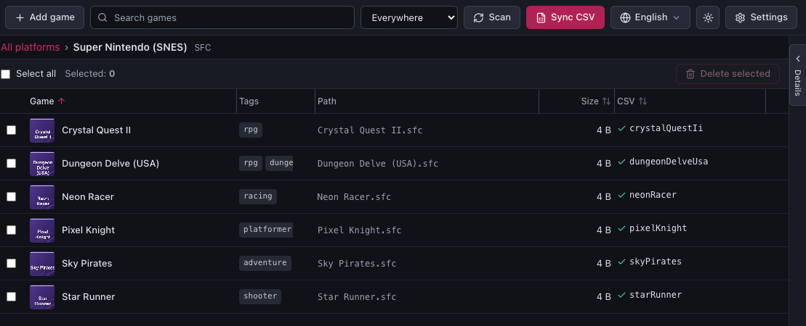
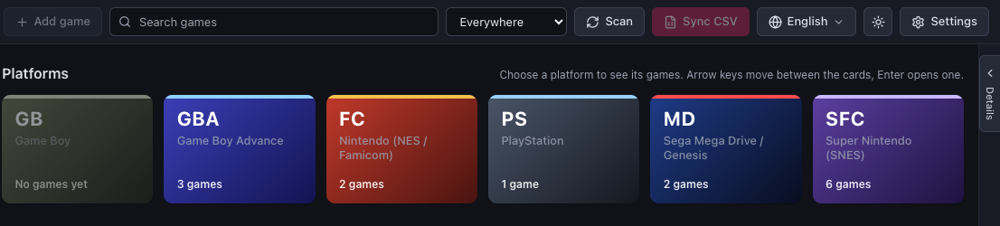

<a href="README.md">English</a> · <b>Українська</b> · <a href="README.ru.md">Русский</a>

# Retro Game Manager

Керуйте іграми на SD-карті вашої ретроконсолі з комп’ютера: додавайте ігри, перейменовуйте їх, додавайте обкладинки й теги, а збереження залишаються з іграми.

## Підтримувані консолі

- SF3000
- SF3000 HD
- SF3000 HD без HDMI
- SF3100
- SF3500

## Завантажити

Останню версію для **Windows**, **macOS** і **Linux** можна завантажити на [сторінці релізів](https://github.com/StanislavDovhusha/retro_game_manager/releases).

| Система                            | Файл                                                                                                                          |
| ---------------------------------- | ----------------------------------------------------------------------------------------------------------------------------- |
| Windows                            | `Retro-Game-Manager-Setup-<версія>.exe` (інсталятор) або `Retro-Game-Manager-<версія>-portable.exe` (працює без встановлення) |
| macOS, Apple Silicon (M1 і новіші) | `Retro-Game-Manager-<версія>-arm64.dmg`                                                                                       |
| macOS, Intel                       | `Retro-Game-Manager-<версія>-x64.dmg`                                                                                         |
| Linux                              | `Retro-Game-Manager-<версія>.AppImage` або `Retro-Game-Manager-<версія>.deb` (Debian, Ubuntu, Mint)                           |

Контрольні суми SHA-256 файлів — у `SHA256SUMS.txt` на сторінці релізу. Щоб перевірити завантажений файл, порівняйте його суму з тією, що в цьому файлі:

- **Windows (PowerShell):** `Get-FileHash .\Retro-Game-Manager-Setup-<version>.exe`
- **macOS:** `shasum -a 256 Retro-Game-Manager-<version>-arm64.dmg`
- **Linux:** `sha256sum -c SHA256SUMS.txt --ignore-missing` (запустіть у теці із завантаженими файлами)

### Перший запуск застосунку без підпису

Застосунок не підписаний платним сертифікатом розробника, тому система один раз перепитає перед першим запуском:

- **Windows:** SmartScreen показує «Windows захистив ваш комп’ютер». Натисніть **Докладніше**, потім **Усе одно запустити**.
- **macOS:** клацніть застосунок у **Програмах** правою кнопкою (або з Control) і виберіть **Відкрити**, потім ще раз **Відкрити**. Або спробуйте відкрити його один раз, потім відкрийте **Системні параметри → Приватність і безпека** й натисніть **Усе одно відкрити**.
- **Linux:** зробіть AppImage виконуваним — у властивостях файлу або командою `chmod +x Retro-Game-Manager-*.AppImage` — і запустіть. Пакет `.deb` встановлюється командою `sudo apt install ./Retro-Game-Manager-*.deb`.

## Як користуватися

> 💡 **Корисно знати:** радимо час від часу робити резервну копію SD-карти. Це займає лише кілька хвилин і зберігає ваші ігри та збереження в безпеці.

1. **Оберіть SD-карту.** Вставте карту в комп’ютер, натисніть **Обрати SD-карту** й виберіть саму карту (її головну теку). Застосунок розпізнає вашу консоль за теками на карті. Модель також можна вибрати в **Налаштуваннях**.
2. **Оберіть платформу.** На головному екрані — платформи карти з кількістю ігор, наприклад GBA, SFC або PS. Клацніть потрібну (або виберіть її на панелі ліворуч): її ігри з’являться в таблиці. **All platforms** над таблицею повертає назад.
3. **Додайте гру.** Натисніть **Додати гру** й перетягніть файл гри у вікно:
   - файл гри цієї платформи (наприклад `.nes`, `.sfc`, `.gba` або `.md`) чи `.zip`;
   - образ диска: `.bin` + `.cue`, набір CloneCD (`.ccd` + `.img` + `.sub`) або `.ecm`. Застосунок перетворить його на один файл, який читає консоль.

   Додайте зображення обкладинки (PNG, JPG або WEBP) — або застосунок намалює обкладинку сам. Теги додаються потім у таблиці.

4. **Редагуйте або видаляйте ігри.** Двічі клацніть назву, коротку назву чи теги гри в таблиці, щоб змінити їх. **Перейменувати гру** на панелі **Подробиці** перейменовує гру разом з обкладинкою та збереженнями. **Видалити файл гри** прибирає гру з карти. Обкладинка й збереження залишаються; обкладинку можна видалити окремо кнопкою **Видалити зображення**.
5. **Шукайте.** Введіть запит у поле пошуку вгорі — пошук іде одразу по іграх усіх платформ.

Під час першого запуску короткий гайд покаже ці кроки. Запустити його знову можна в **Налаштування → Пройти гайд знову**.

## Підтримати проєкт

Якщо Retro Game Manager заощаджує вам час, підтримайте його на [Ko-fi](https://ko-fi.com/stanislav31259). Кожен донат трохи наближає підтримку наступної консолі.

А ⭐ зірка на [GitHub](https://github.com/StanislavDovhusha/retro_game_manager) допомагає іншим гравцям знайти проєкт.

## Ліцензія

Retro Game Manager — вільне програмне забезпечення за ліцензією GNU General Public License v3.0 (GPL-3.0). Див. [LICENSE.md](LICENSE.md).
