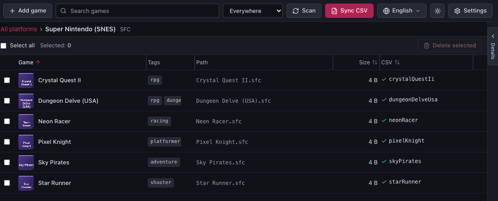

# Retro Game Manager 1.0.0

The first release of **Retro Game Manager** — manage the games on the SD card of your retro handheld from your computer.

## What it does

- **See your card at a glance.** The platforms on the card appear as cards, with the number of games on each.
- **Add games by dragging them into the window** — single files, `.zip`, and disc images (`.bin` + `.cue`, CloneCD, `.ecm`), which become one file the console can read. A game can be packed into a `.zip` on the way.
- **Covers:** use your own picture, or let the app draw one in the colours of the platform.
- **Rename safely.** The game file, its cover, saves, quick saves and the console's own game lists are renamed together. If anything goes wrong, everything is put back.
- **Edit titles, short names and tags** right in the table; delete games or only their covers.
- **Keep `filelist.csv` and the console's lists (all games, favourites, recent) in sync** with what is really on the card, with a preview first.
- **Search** across every platform at once, and **start a game in an emulator** on your computer (OpenEmu on macOS, RetroArch on Windows and Linux).
- **Safe by design:** every list is backed up on your computer before it changes, and nothing of the app is left on the card.
- **13 languages:** English, Ukrainian, Russian, German, Polish, Spanish, French, Italian, Japanese, Simplified Chinese, Korean, Czech and Kazakh.

The full list is in the [changelog](https://github.com/StanislavDovhusha/retro_game_manager/blob/v1.0.0/CHANGELOG.md).

## Supported consoles

SF3000 · SF3000 HD · SF3000 HD without HDMI · SF3100 · SF3500

## Which file to download

| Your computer                            | File                                                                                                                             |
| ---------------------------------------- | -------------------------------------------------------------------------------------------------------------------------------- |
| Windows (64-bit)                         | `Retro-Game-Manager-Setup-1.0.0.exe` — the installer. Or `Retro-Game-Manager-1.0.0-portable.exe`, which runs without installing. |
| Mac with Apple Silicon (M1, M2, M3, M4…) | `Retro-Game-Manager-1.0.0-arm64.dmg`                                                                                             |
| Mac with an Intel processor              | `Retro-Game-Manager-1.0.0-x64.dmg`                                                                                               |
| Linux (64-bit)                           | `Retro-Game-Manager-1.0.0.AppImage` (any distribution), or `Retro-Game-Manager-1.0.0.deb` for Debian, Ubuntu and Mint            |

Not sure which Mac you have? Open the Apple menu → **About This Mac**: "Chip Apple M…" means Apple Silicon, "Processor Intel" means Intel.

`SHA256SUMS.txt` holds the SHA-256 checksums of all files.

## First start

The app is not signed with a paid developer certificate, so your system asks once before the first start:

- **Windows:** SmartScreen says "Windows protected your PC". Click **More info**, then **Run anyway**.
- **macOS:** drag the app to **Applications**, then right-click (or Control-click) it and choose **Open**, and **Open** again. Or try to open it once, then go to **System Settings → Privacy & Security** and click **Open Anyway**.
- **Linux:** make the AppImage executable (file properties, or `chmod +x Retro-Game-Manager-1.0.0.AppImage`) and start it. The `.deb` installs with `sudo apt install ./Retro-Game-Manager-1.0.0.deb`.

> 💡 Back up your SD card from time to time — it takes a few minutes and keeps your games and saves safe.

Upgrading from an earlier test build ("Game Manager")? Your settings, backups and logs move over automatically on the first start.

## Support the project

If Retro Game Manager saves you time, you can support it on [Ko-fi](https://ko-fi.com/stanislav31259) — each donation brings support for the next console a little closer. A ⭐ star on [GitHub](https://github.com/StanislavDovhusha/retro_game_manager) helps other players find it.

Found a problem? [Open an issue](https://github.com/StanislavDovhusha/retro_game_manager/issues).

---

Retro Game Manager is free software under the GNU General Public License v3.0 or later.
